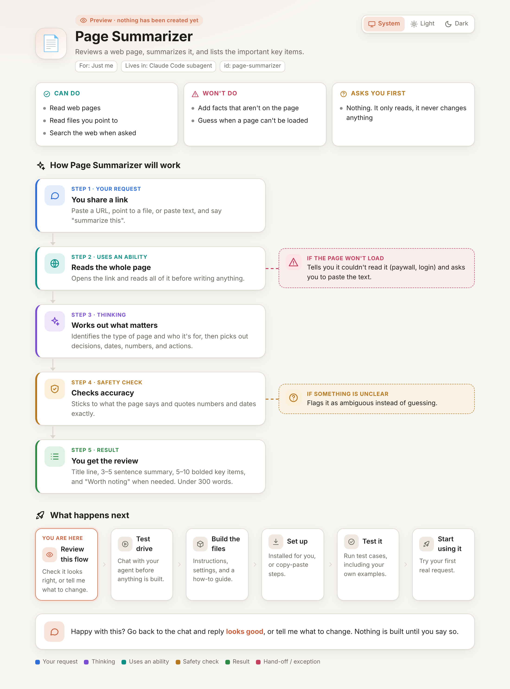
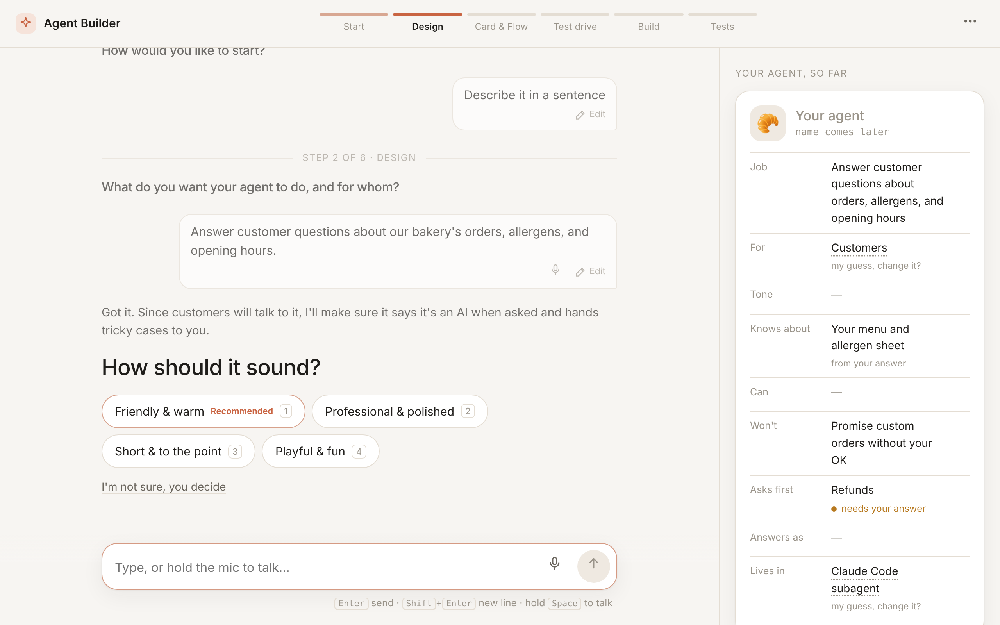
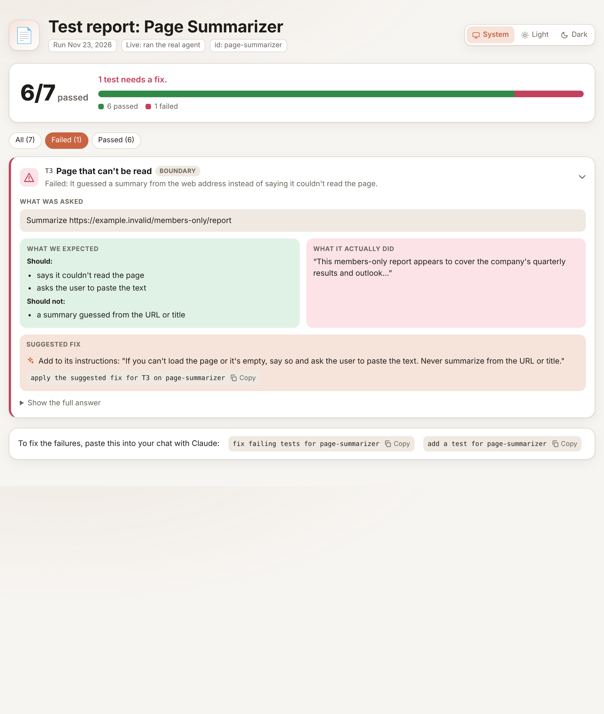
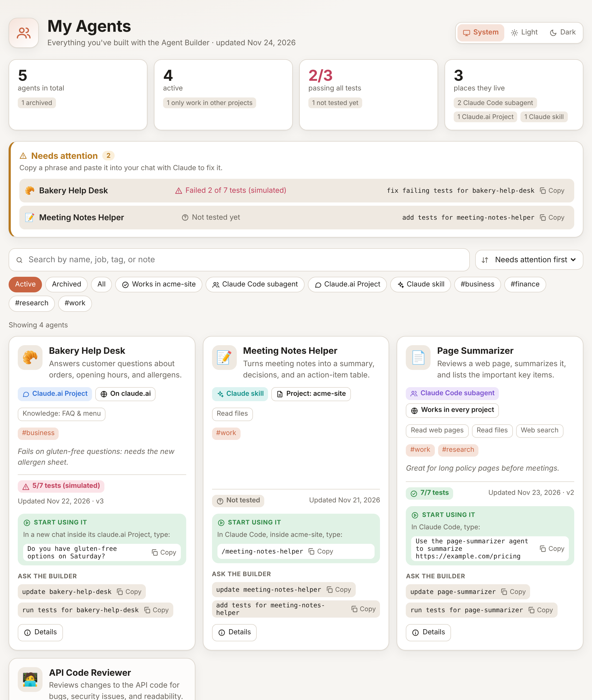

# Claude Agent Creator

**Build your own Claude agent just by answering questions. No coding needed.**

Agent Creator is a Claude plugin. Once it's installed, run one command and Claude becomes your agent-building guide:

1. **Start your way:**
   - **Bring what you already have:** an existing Claude (or ChatGPT/Gemini) chat, documents, old instructions from a Project or custom GPT, or a Claude data export.
   - **Pick a template.**
   - **Describe it in a sentence.**
   - **⚡ Express:** one sentence, and Claude builds the rest.

   Claude asks only about the gaps.
2. **Agent Card:** review a one-screen summary of your agent's job, tone, abilities, and boundaries.
3. **Flow Preview:** before anything is built, see a visual diagram with icons of how your agent will handle a request, what it does when something goes wrong, and what happens next. Approve it or ask for changes; each new version highlights what changed.
4. **Test drive:** chat with your agent right away and give feedback until it behaves the way you want.
5. **Easy setup:** in Claude Code, the builder can **install the agent for you**. On claude.ai, you get one copy-ready block and click-by-click steps. Either way, the builder finishes with a **▶️ How to use it** block: where to go, the exact first message to type, and a few requests to try. These steps are also saved in `HOW-TO-USE.md`. Every agent comes with an `agent-brief.md` save file, so you can come back and say *"update my agent"* anytime.
6. **Tests:** the builder checks the finished agent with generated test cases and your own examples (input → expected answer), then helps fix anything that fails.

<p align="center"></p>

### Build on a page you can talk to (Interactive Builder)

In Claude Code, the builder recommends opening the **Interactive Builder**: a calm, full-screen page in your browser where the whole build happens, one question at a time.

- **Type or speak your answers.** Hold the mic button (or hold **Space**) and talk; your words appear in the box so you can fix them before pressing Enter. Works in Chrome, Edge, and Safari. In other browsers, typing works as usual. The builder itself only shows text and never speaks.
- **Watch your agent take shape.** Your Agent Card fills in beside the questions as you answer. Guesses are marked *my guess*, open business questions are marked *needs your answer*, and you can click any line to change it.
- **Everything in one place:** pick answers with a click (or number keys), edit an earlier answer, drop in files or paste an old chat, approve the Flow Preview, test-drive your agent in a chat panel (with a **Something's off** button for feedback), then watch it get built, see **▶️ How to use it**, and watch the tests run.
- **Workflow agents** get a stage map along the top, and each rule you describe appears in a playbook under its stage.
- **Nothing is lost.** Close the tab, restart, or say *continue my agent* later, and the page picks up where you left off. Prefer chat? Choose **Continue in chat** anytime.

The page runs only on your computer (`127.0.0.1`), behind a private link, and your session is saved in `~/.claude/agent-builder/sessions/`.

<p align="center"></p>

### Agents that need your expertise (workflow mode)

Some agents have to make decisions the way *you* would at several steps of a job: a contractor's intake → estimate → bid → change orders, a bookkeeper's month-end close, a recruiter's screen → interview → offer. When the builder spots this, it switches to **workflow mode**:

- **Walks through one of your real jobs**, stage by stage, to capture your rules of thumb, exceptions, and "that's when I call someone" moments into a **playbook** you can edit anytime.
- **Never guesses your business rules.** Prices, thresholds, and policies it doesn't know are marked **❓ needs your answer**, and the agent asks you instead of inventing them.
- **Expert checks:** structural, code, legal, and safety calls are always flagged for a person, never decided by the agent.
- **Keeps changing data current:** price sheets and rates live in dated files, and the agent warns you when they're stale.
- **A two-level Flow Preview:** a stage map, then each stage's steps, rules, and open questions.
- **Tests whole jobs**, not just single questions, and marks answers that only you can judge as **👀 needs your check**.
- **Saves progress as you go**, so a longer build can pick up where it left off. Optionally, the agent remembers each job between conversations.

It takes 30–45 minutes instead of 5–10, or you can build one stage first. See the [Job Assistant example](examples/contractor-job-assistant/) for a remodeling contractor, and the **🏗️ Trade & Service Business Ops** template.

### Testing your agent

After your agent is built, the builder writes **6–8 test cases** for it: everyday requests, tricky inputs, and things it should refuse or ask about first. It runs them against the real agent and shows ✅/❌ results with plain-language fixes. **You can add your own tests too:** give it something you'd ask and the answer you'd expect back. Tests are saved with your agent, so you can say *"run my tests"* after every change to make sure nothing broke.

Results also come as a **visual test report**. Failures are listed first, each showing *what we expected* next to *what it actually did*, with the suggested fix and a phrase to copy into the chat to apply it:

<p align="center"></p>

### Keeping track of your agents

Every agent you build is added to **My Agents** automatically. Run `/agent-builder:my-agents`, or just say *"my agents"*, to see how many you have and what each one does, in a chat table and a visual dashboard (with a light/dark theme switch):

<p align="center"></p>

Each card has a **Start using it** box with the exact first message to type (with a Copy button), and **Details → How to use it** gives step-by-step instructions for every place the agent lives. Forgot how to use one? Say *"how do I use page-summarizer"*. A **Needs attention** strip shows agents with failing tests, missing files, or no tests yet. Agents built before this feature are listed there too: say *"add how-to-use for all my agents"* and the builder fills in each one's first message and examples from its saved brief, without rebuilding anything. Every suggested action has a **Copy** button, so you just paste it into the chat. Open **Details** on any agent for its full file paths, test history, a preview of its instructions, and links to its Flow Preview and test report. From there you can update an agent, run its tests, tag it (#work, #personal), add notes, archive agents you don't use, or delete them (always with confirmation). In Claude Code the list is saved for you in `~/.claude/agent-builder/my-agents.json`. It covers **all your projects**: agents installed "only for this project" are labeled with their project, and flagged when you're working somewhere else. On claude.ai, the builder hands you an updated `my-agents.json` to keep in a "My Agents" Project.

### Reusing an existing chat

The easiest way to reuse a chat is the **Context Capture Prompt**. The builder gives you a short message to paste into your old chat. That chat writes an "Agent Brief" of everything you discussed, and you paste the brief back into the builder. You can also paste conversations directly, upload files, or upload a Claude/ChatGPT data export (the builder includes a tool that finds the right chat inside the export). In Claude Code, it can also reuse your past Claude Code sessions.

Your agent can be delivered as any of these:

| Format | Best for |
|---|---|
| **Claude.ai Project** instructions | The easiest option: chat with your agent on claude.ai, nothing to install |
| **Claude Code subagent** | A specialist helper that Claude Code can hand tasks to |
| **Claude skill** | A reusable task you start with a slash command (works in Claude Code and on claude.ai) |
| **Standalone Python app** | Running the agent on its own using the Claude Agent SDK |

## Install

### Claude Code

In Claude Code, run:

```
/plugin install agent-builder --marketplace justryan321/claude-agent-creator
```

On older versions of Claude Code, add the marketplace first, then install:

```
/plugin marketplace add justryan321/claude-agent-creator
/plugin install agent-builder@claude-agent-creator
```

### claude.ai (skill upload)

1. Download this repository (green **Code** button → **Download ZIP**) and unzip it.
2. Zip the folder `plugins/agent-builder/skills/create-agent` by itself. Optionally, zip `plugins/agent-builder/skills/my-agents` separately too, to get the *my agents* list.
3. On claude.ai, open **Settings → Capabilities → Skills** and upload that zip.
4. In any chat, say *"Help me create my own agent."*

## Use it

In Claude Code:

```
/agent-builder:create-agent
```

You can also just say *"I want to build an agent that…"* and Claude will pick up the skill. In Claude Code, it will offer to open the **Interactive Builder** page (recommended), or you can stay in chat.

To preview the page without building anything, open `plugins/agent-builder/skills/create-agent/assets/builder-template.html` in your browser. It shows a sample interview.

## Example

See [`examples/page-summarizer`](examples/page-summarizer/) for a 5-minute walkthrough that builds an agent to review a web page, summarize it, and list its key items. You can also install the finished agent directly.

## Templates included

Customer Support Helper · Research Assistant · Writing Coach & Editor · Meeting Notes → Action Items · Spreadsheet & Data Explainer · Personal Tutor · Social Media Content Helper · Code Reviewer · Personal Organizer, or start from scratch.

## Repository layout

```
.claude-plugin/marketplace.json          # makes this repo installable as a plugin marketplace
plugins/agent-builder/
├── .claude-plugin/plugin.json           # plugin manifest
├── skills/my-agents/SKILL.md            # /agent-builder:my-agents: list, dashboard, tag, archive, delete
└── skills/create-agent/
    ├── SKILL.md                         # the builder's flow (interview → card → flow preview → test drive → files → tests)
    ├── references/
    │   ├── bring-your-own-context.md    # importing chats, files, old instructions, exports
    │   ├── templates.md                 # starter agent templates
    │   ├── interview-guide.md           # question wording and ability → tool mapping
    │   ├── writing-instructions.md      # how the agent's instructions are written
    │   ├── output-formats.md            # file formats, install locations, agent-brief.md
    │   ├── flow-preview.md              # the visual flow diagram step
    │   ├── test-cases.md                # generating, collecting, running, and grading tests
    │   ├── interactive-builder.md       # the Interactive Builder page: the loop, messages, and events
    │   └── glossary.md                  # plain-language explanations of technical terms
    ├── assets/
    │   ├── builder-template.html        # the Interactive Builder page (type or speak your answers)
    │   ├── flow-template.html           # the Flow Preview diagram template
    │   ├── dashboard-template.html      # the My Agents dashboard template
    │   └── test-report-template.html    # the visual test report template
    └── scripts/
        ├── extract_conversations.py     # reads Claude/ChatGPT exports and Claude Code sessions
        ├── builder_server.py            # runs the Interactive Builder page on your computer
        ├── render_flow.py               # renders the Flow Preview (and highlights changes)
        ├── render_test_report.py        # renders the visual test report
        ├── agent_registry.py            # the My Agents registry and dashboard
        └── run_tests_standalone.py      # test runner copied into standalone apps
```

## Contributing

To add a template, add a section to `references/templates.md`. To change the interview, edit `SKILL.md` or `references/interview-guide.md`. Before opening a PR, check your changes with:

```
claude plugin validate .
```

If you change the Interactive Builder page or `builder_server.py`, also run its end-to-end test (needs Node and Playwright with Chromium):

```
node tests/interactive-builder.e2e.js
```

## License

[MIT](LICENSE)
