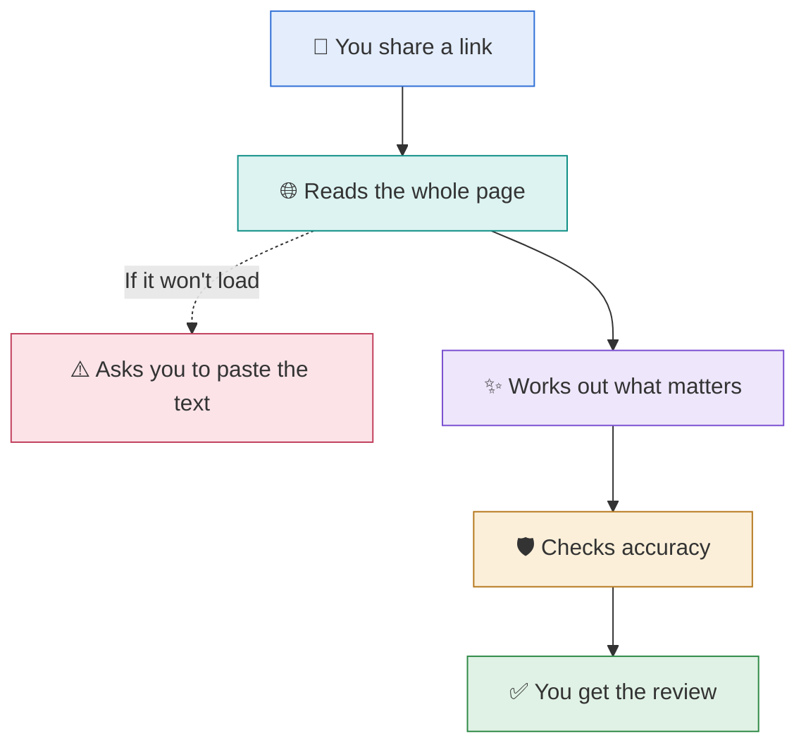

# Flow Preview: show the plan before building

Once the interview is done, and before the test drive and before any files are created, show the user a **visual flow diagram** of how their agent will work and what happens next. Non-technical users understand a picture far better than a list of settings, and it's the cheapest moment to catch a misunderstanding.

The diagram comes from a fixed, polished template (`assets/flow-template.html`), filled with a small JSON spec. It adapts to phones and has a System / Light / Dark theme switch, shared with the My Agents dashboard. Don't hand-draw a new design each time; fill the template so every preview looks consistent.

## 1. Write the flow spec

Build it from the Agent Card. Use plain words: these are what the user reads.

```json
{
  "agent": {
    "name": "<Display Name>",
    "id": "<agent-id>",
    "emoji": "<one emoji that fits the job>",
    "tagline": "<one-sentence job>",
    "home": "<where it lives, e.g. Claude.ai Project>",
    "for": "<who uses it>"
  },
  "glance": {
    "can": ["<ability in plain words>", "..."],
    "wont": ["<key boundary>", "..."],
    "asks_first": ["<action needing confirmation>"]
  },
  "steps": [
    {"kind": "input",  "icon": "message", "title": "<what the user does>", "detail": "<one sentence>"},
    {"kind": "tool",   "icon": "globe",   "title": "<what it uses>", "detail": "<…>",
     "branch": {"kind": "handoff", "icon": "alert", "when": "If <exception>", "then": "<what it does instead>"}},
    {"kind": "think",  "icon": "sparkles", "title": "<how it works it out>", "detail": "<…>"},
    {"kind": "guard",  "icon": "shield",  "title": "<safety/quality check>", "detail": "<…>"},
    {"kind": "output", "icon": "list",    "title": "<what the user gets>", "detail": "<format and length>"}
  ],
  "next": null
}
```

Rules:
- **4–7 steps.** Always start with one `input` step (what the user does) and end with one `output` step (what they get). Merge minor steps.
- **Step kinds** (each has its own color): `input` (user's request), `think` (reasoning/deciding), `tool` (an ability: web, files, apps, code), `guard` (safety or quality check, or confirmation), `output` (result), `handoff` (sending to a human or stopping).
- **Branches** show what happens off the happy path. Put one next to the step where it occurs, and add one for each important boundary, ask-first action, or human handoff. Use 1–3 branches total. `when` starts with "If…".
- **Asks-first actions** become a `guard` step or branch, e.g. "If it's about to send an email → shows you the draft and waits for your yes".
- **Icons** (pick the closest): `message`, `user`, `users`, `book` (knowledge), `globe` (web), `search`, `file`, `edit`, `plug` (app connection), `mail`, `calendar`, `clock`, `chart`, `terminal` (runs code), `sparkles` (thinking), `shield`, `alert`, `help`, `list`, `check`, `eye`, `handoff`, `play`, `package`, `download`, `rocket`.
- `"next": null` uses the standard "What happens next" strip (Review this flow → Test drive → Build the files → Set up → Test it → Start using it). Only override it if the plan really differs (for example, no test drive), with a list of `{"icon", "title", "detail"}`.
- No secrets or other people's personal data, the same as in the agent files.

## 2. Show it (pick the best option the environment supports)

1. **Artifacts available** (claude.ai, Claude Desktop): read `assets/flow-template.html`, replace everything between `/*FLOW_DATA_START*/` and `/*FLOW_DATA_END*/` with the spec JSON (escape any `</` as `<\/`), and present the result as an **HTML artifact** titled "<Display Name>: Flow Preview". If you can't read the template file, make a Mermaid artifact instead (see below).
2. **File and shell tools** (Claude Code): render it with the script, into the agent's output folder:
   ```bash
   python3 <skill-dir>/scripts/render_flow.py <spec.json> ./<agent-id>/agent-flow.html --open
   ```
   Save the spec as `./<agent-id>/flow.json` first. `--open` opens it in their browser. If that doesn't work (remote or headless machine), give them the full file path and say "open this file in your web browser". `<skill-dir>` is the folder containing this skill's `SKILL.md`.
3. **Neither:** show the text version only (below).

**Always** also put the compact text version in the chat, so the user can review it without leaving the conversation:

```
🧭 How <Display Name> will work

 1. 💬 You share a link
        ↓
 2. 🌐 Reads the whole page ──▶ ⚠️ If it won't load: asks you to paste the text
        ↓
 3. ✨ Works out what matters
        ↓
 4. 🛡️ Checks accuracy ──▶ ❓ If unclear: flags it instead of guessing
        ↓
 5. ✅ You get the review (summary + key items, under 300 words)

Next: 👀 Review (you are here) → 🧪 Test drive → 📦 Build files → ⬇️ Set up → ✅ Test it → 🚀 Use it
```

### Mermaid fallback



## 3. Get the go-ahead

Ask: "Here's how **<Display Name>** will work. Does this look right? Reply **looks good** to try it out, or tell me what to change."

- On changes: update the Agent Card and the spec, re-render, and show it again **with the changes highlighted**, so the user can see their feedback was applied. Keep it quick: only re-show the diagram, not the whole explanation.
  - **Claude Code:** before editing, copy the current spec to `./<agent-id>/flow.prev.json`, then render with `--previous`:
    ```bash
    python3 <skill-dir>/scripts/render_flow.py ./<agent-id>/flow.json ./<agent-id>/agent-flow.html --previous ./<agent-id>/flow.prev.json --open
    ```
    The script tags new and changed steps ("New" / "Updated"), lists removed steps, marks new "at a glance" items, and shows a short "what changed" banner.
  - **Artifact (no script):** mark the changes in the spec yourself before filling the template:
    - `"change": "new"` or `"change": "updated"` on each affected step
    - `"removed_steps": ["<old step title>", ...]`
    - `"glance_new": {"wont": ["<new item>"]}` (keys `can`, `wont`, `asks_first`)
    - `"revision": <version number>`
  - In the chat text version, put `(new)` or `(changed)` after those steps.
- Don't move on to the test drive or build anything until the user approves.
- In Express mode, still show the preview. It's the user's main chance to catch a wrong assumption.
- Keep the final `flow.json` and `agent-flow.html` in the agent's output folder (see `output-formats.md`).
